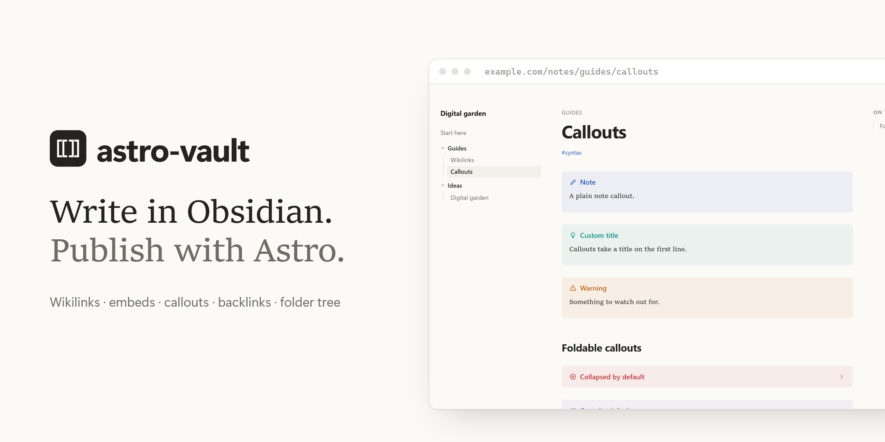
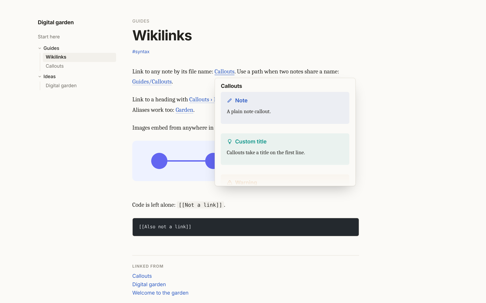
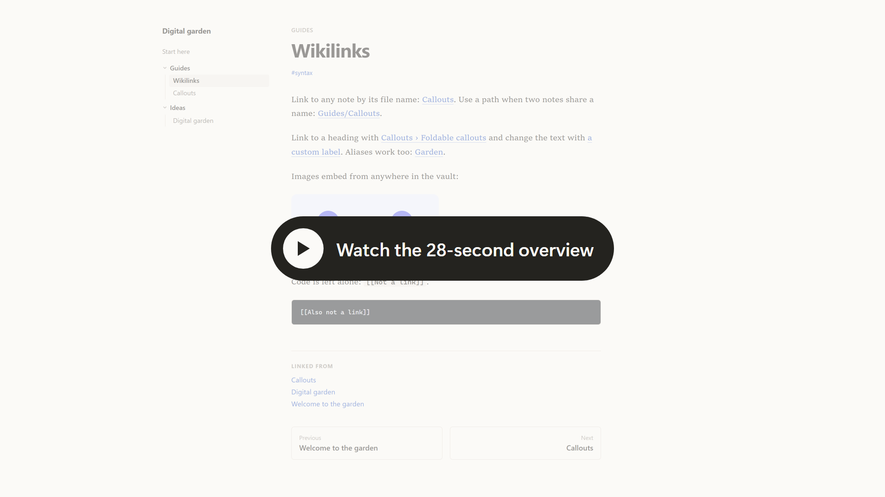

<p align="center">
  
</p>

<p align="center">
  <a href="https://www.npmjs.com/package/astro-vault"></a>
  <a href="https://github.com/manuel-cerezo/astro-vault/actions/workflows/ci.yml"></a>
  
  <a href="./LICENSE"></a>
</p>

<p align="center">
  <b>Write in Obsidian. Publish with Astro.</b><br>
  <a href="./packages/astro-vault/README.md">Documentation</a> · <a href="./examples/basic">Example site</a> · <a href="https://www.npmjs.com/package/astro-vault">npm</a>
</p>

# astro-vault

Publish an [Obsidian](https://obsidian.md) vault as part of any Astro site. You keep writing in Obsidian; `astro build` turns the vault into pages with:

| Feature              | What you get                                                                                |
| -------------------- | ------------------------------------------------------------------------------------------- |
| **Wikilinks**        | `[[Note]]`, `[[Folder/Note]]`, `[[Note#Heading]]`, `[[Note\|label]]` and aliases            |
| **Image embeds**     | `![[image.png]]` from anywhere in the vault, optimized by Astro                             |
| **Callouts**         | `> [!tip] Title`, including foldable ones                                                   |
| **Backlinks**        | Every note knows which notes link to it                                                     |
| **Navigation**       | Folder tree, breadcrumbs and previous / next links                                          |
| **Your design**      | Content collections, `.md` and `.mdx`, no client JavaScript, unstyled components            |
| **Ready-made pages** | `pages: true` publishes the vault with a clean theme, dark mode and English or Spanish text |



<a href="https://github.com/manuel-cerezo/astro-vault/raw/develop/assets/astro-vault-promo.mp4"></a>

## Get started

```sh
npx astro add astro-vault
```

Add the collection, set `vault({ pages: true })` and write. The [quick start](./packages/astro-vault/README.md#quick-start) has the two snippets, and [`examples/pages`](./examples/pages) is the same setup ready to copy. To use your own design, see [`examples/basic`](./examples/basic).

## Repository

| Folder                 | Contents                                                                              |
| ---------------------- | ------------------------------------------------------------------------------------- |
| `packages/astro-vault` | The npm package: integration, loader, Markdown plugin, runtime, components.           |
| `examples/pages`       | The zero-config setup: `pages: true` and the notes. CI builds it and checks its HTML. |
| `examples/basic`       | A site with its own layout and the components. CI builds it and checks its HTML.      |
| `assets`               | Banner, screenshots and the promo video, made with Remotion in `assets/video`.        |

## Development

Requires Node 22.12+ and pnpm (`corepack enable`).

```sh
pnpm install
pnpm test          # unit tests of the package
pnpm test:example  # build the package and the example, then check the example's HTML
pnpm validate      # format, types, tests and example: what CI runs
pnpm --filter example-basic dev
```

## Branches and releases

- **`develop`** is the default branch. Day-to-day commits and pull requests go there, and CI checks every push.
- **`main`** is the release branch. Every push to `main` runs the [release workflow](./.github/workflows/release.yml). It validates the repository, works out the next version from the commit messages since the last release, publishes it to npm with provenance, and creates the `vX.Y.Z` tag and the GitHub release with its notes.

To release what is on `develop`:

```sh
pnpm release   # fast-forwards main to origin/develop
```

It only moves `main` forward, so it stops if `main` has commits that `develop` does not.

The version comes from [Conventional Commits](https://www.conventionalcommits.org):

| Commit                                       | Release                   |
| -------------------------------------------- | ------------------------- |
| `fix: …`, `perf: …`                          | patch (`0.1.0` → `0.1.1`) |
| `feat: …`                                    | minor (`0.1.0` → `0.2.0`) |
| `feat!: …` or a `BREAKING CHANGE:` footer    | major (`0.x` → `1.0.0`)   |
| `docs`, `test`, `chore`, `ci`, `refactor`, … | no release                |

While the package is `0.x`, ship breaking changes as `feat` and explain them in the commit body: a `!` releases `1.0.0`.

The `version` in `packages/astro-vault/package.json` is a placeholder. The real version lives in the git tags and on npm.

**npm access.** Until trusted publishing is set up, the workflow publishes with the `NPM_TOKEN` repository secret, an npm granular access token with read and write access to packages. Once the package exists on npm, configure [trusted publishing](https://docs.npmjs.com/trusted-publishers) for this repository and the `release.yml` workflow, then delete the secret.

## License

[MIT](./LICENSE)
