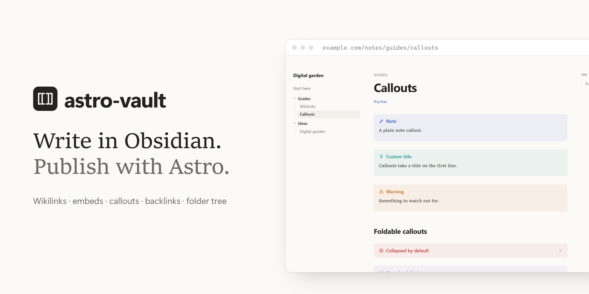
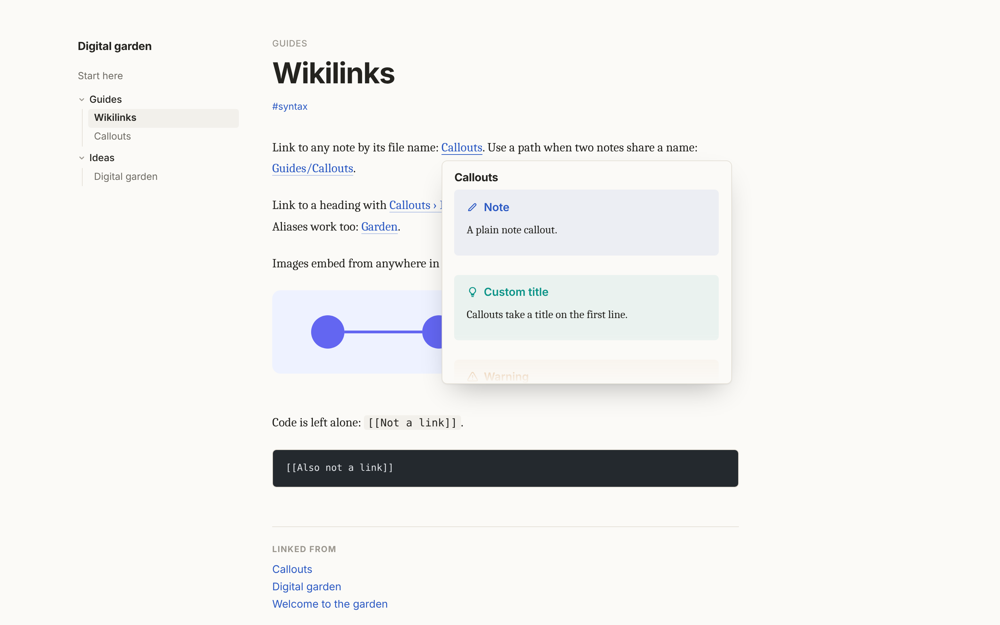
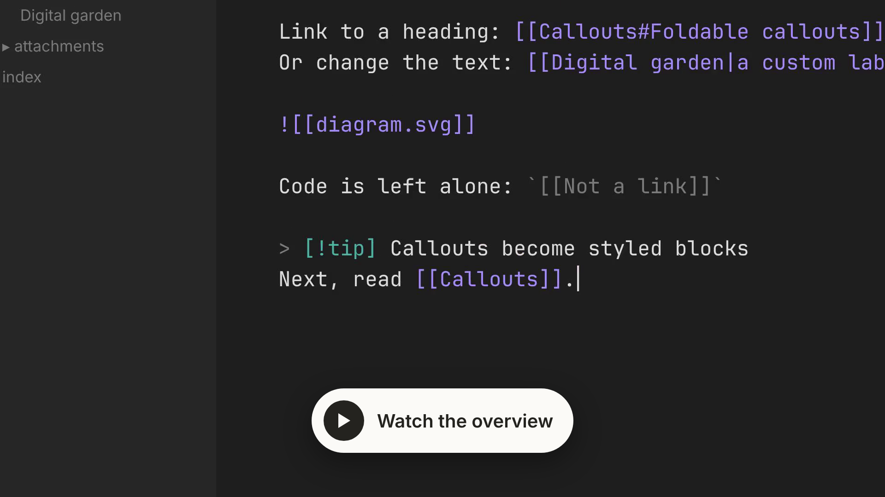
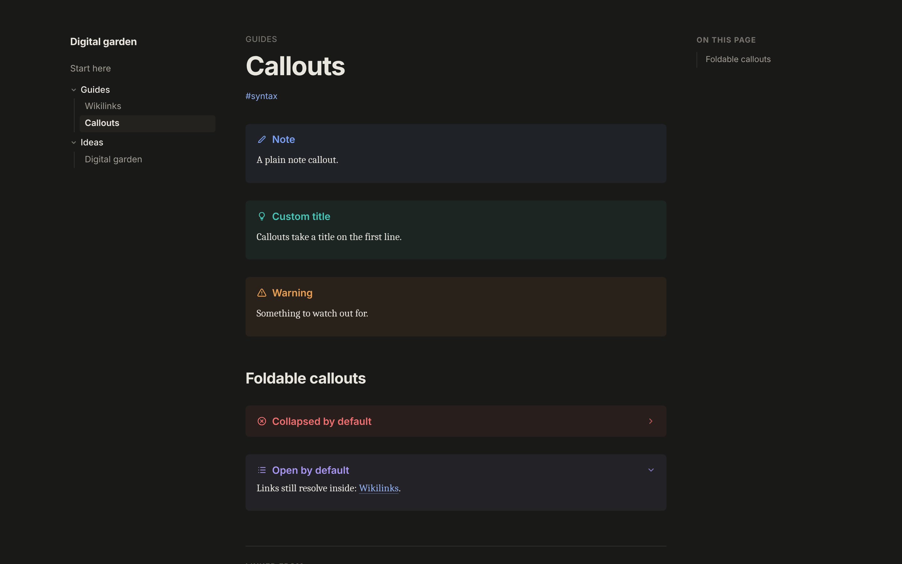
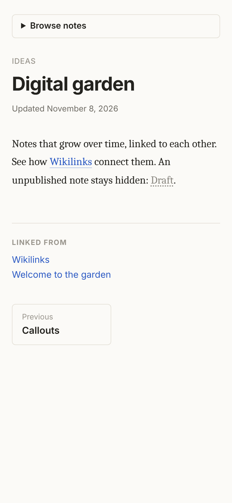

<p align="center">
  
</p>

<p align="center">
  <a href="https://www.npmjs.com/package/astro-vault"></a>
  <a href="https://github.com/manuel-cerezo/astro-vault/actions/workflows/ci.yml"></a>
  
  <a href="https://github.com/manuel-cerezo/astro-vault/blob/develop/LICENSE"></a>
</p>

<p align="center">
  <b>Write in Obsidian. Publish with Astro.</b><br>
  <a href="#quick-start">Quick start</a> · <a href="#supported-syntax">Syntax</a> · <a href="#options">Options</a> · <a href="#runtime-api">API</a> · <a href="https://github.com/manuel-cerezo/astro-vault/tree/develop/examples/basic">Example site</a>
</p>

# astro-vault

Publish an [Obsidian](https://obsidian.md) vault as part of any Astro site. You write in Obsidian and Astro builds the pages: `[[wikilinks]]`, `![[image]]` embeds, callouts, backlinks, a folder tree and previous / next links, all on top of Astro's own content collections.

- **Ready in two files.** Turn on the built-in pages and every note gets a clean, readable page with light and dark mode. No layout to write.
- **Or your own design.** Keep your pages and use the data, the components and the styles you need.
- **Built for Astro 7.** It runs on Sätteri, Astro's default Markdown processor, and works with `.md` and `.mdx` notes.
- **Static output.** Everything is resolved at build time. The built-in pages add a small script for smooth navigation and link previews, which you can turn off.

> Status: early `0.x`. The API may change between minor versions until 1.0.

<p align="center">
  
</p>

<a href="https://github.com/manuel-cerezo/astro-vault/raw/develop/assets/astro-vault-promo.mp4"></a>

## Quick start

### 1. Install

```sh
npx astro add astro-vault
```

This installs the package and adds `vault()` to your `astro.config`. To install it by hand, add the integration yourself (see step 3).

### 2. Add the collection

```ts
// src/content.config.ts
import { defineCollection } from 'astro:content';
import { vaultLoader, vaultSchema } from 'astro-vault/loader';

export const collections = {
  notes: defineCollection({ loader: vaultLoader(), schema: vaultSchema })
};
```

### 3. Turn on the pages

```js
// astro.config.mjs
import { defineConfig } from 'astro/config';
import vault from 'astro-vault';

export default defineConfig({
  integrations: [vault({ pages: true, title: 'My garden' })]
});
```

That's it. Every note in `src/content/notes` is published at `/notes`, with the folder tree, breadcrumbs, table of contents, backlinks, previous / next links and dark mode. `index.md` becomes the landing page; without one, `/notes` lists every note.

Moving between notes feels like Obsidian: links are prefetched on hover, pages change without a full reload while the sidebar keeps its place, and hovering a wikilink previews the note. This uses Astro's `ClientRouter` and a small script; set `navigation: false` and `previews: false` to ship no JavaScript at all.

Set `lang: 'es'` for Spanish interface text, or override any label with `labels`. To use your own design instead, skip this step and follow [Your own pages](#your-own-pages).

### 4. Write in Obsidian

In Obsidian, choose **Open folder as vault** and select `src/content/notes`. Folders become the tree. Pasted images can live anywhere in the vault, for example in `attachments/`.

Add `.obsidian/` to your `.gitignore`: it holds per-device settings that change every time Obsidian opens.

[`examples/pages`](https://github.com/manuel-cerezo/astro-vault/tree/develop/examples/pages) is this setup, ready to copy.

<table>
  <tr>
    <td width="70%"></td>
    <td width="30%"></td>
  </tr>
</table>

## Your own pages

Leave `pages` off and render the notes with your own pages and layout. A minimal page:

```astro
---
// src/pages/notes/[...slug].astro
import { getVault } from 'astro-vault/runtime';
import { render, type CollectionEntry } from 'astro:content';
import Backlinks from 'astro-vault/components/Backlinks.astro';
import VaultTree from 'astro-vault/components/VaultTree.astro';
import 'astro-vault/styles.css';
import 'astro-vault/theme.css';

export async function getStaticPaths() {
  const vault = await getVault<CollectionEntry<'notes'>>();
  return vault.notes
    .filter((note) => !vault.isHome(note.id))
    .map((note) => ({ params: { slug: note.id }, props: { note } }));
}

const { note } = Astro.props;
const vault = await getVault<CollectionEntry<'notes'>>();
const { Content } = await render(note);
---

<html lang="en">
  <head>
    <meta charset="utf-8" />
    <title>{vault.titles.get(note.id)}</title>
  </head>
  <body>
    <VaultTree vault={vault} currentId={note.id} />
    <h1>{vault.titles.get(note.id)}</h1>
    <Content />
    <Backlinks vault={vault} id={note.id} />
  </body>
</html>
```

- Keep the `<meta charset="utf-8" />`: without it, accented characters in your notes render garbled.
- `theme.css` styles the components the way the built-in pages do. Leave it out to style them yourself.
- To keep the built-in layout but control the routes, wrap the content in `<VaultLayout vault={vault} note={note} headings={headings}>`.
- Add `src/content/notes/index.md` as the landing note and render `vault.home` the same way from `src/pages/notes/index.astro`.

[`examples/basic`](https://github.com/manuel-cerezo/astro-vault/tree/develop/examples/basic) is a complete site with its own layout.

### Another folder or URL

The defaults are a vault in `src/content/notes` published at `/notes`. To change them, pass the same options to the integration and the loader. A shared file keeps them in one place:

```ts
// src/vault.config.ts
import { defineVaultConfig } from 'astro-vault/config';

export default defineVaultConfig({ dir: 'vault', basePath: '/garden' });
```

```js
// astro.config.mjs
integrations: [vault({ ...vaultConfig, pages: true })];
```

```ts
// src/content.config.ts
notes: defineCollection({ loader: vaultLoader(vaultConfig), schema: vaultSchema });
```

## Supported syntax

| Syntax                      | Result                                                                                                     |
| --------------------------- | ---------------------------------------------------------------------------------------------------------- |
| `[[Note]]`                  | Link to the note with that file name, slug or alias, anywhere in the vault.                                |
| `[[Folder/Note]]`           | Link by path, for names that exist in more than one folder.                                                |
| `[[Note#Heading]]`          | Link to a heading. The label reads "Note › Heading".                                                       |
| `[[Note\|label]]`           | Link with custom text.                                                                                     |
| `![[image.png]]`            | Image from anywhere in the vault, optimized by Astro at build time.                                        |
| `> [!type] Title`           | Callout with an icon: `<blockquote class="callout" data-callout="type">` and a `.callout-title` paragraph. |
| `> [!type]-` / `> [!type]+` | Foldable callout: a `<details>` that opens and closes without JavaScript (`+` starts open).                |
| `[[Missing note]]`          | `<span class="wikilink wikilink-missing">` instead of a broken link. Drafts count as missing.              |

`[[...]]` inside inline code and code blocks is left as text.

**How names resolve.** A bare name matches a note's file name first, then its slug, then its `aliases`. When several notes share a name, the one closest to the vault root wins, as in Obsidian. Use `[[Folder/Note]]` to pick another one. The build log lists every name shared by several notes and where a bare link goes, and warns when two files would publish at the same URL.

**Not supported yet:** note embeds (`![[Other note]]`), block references (`^id`), image sizes (`![[image.png|300]]`), Dataview and Canvas.

## Frontmatter

Every property is optional, so a note created in Obsidian builds as-is.

| Property      | Type           | Effect                                                               |
| ------------- | -------------- | -------------------------------------------------------------------- |
| `title`       | string         | Page and tree title. Defaults to the file name.                      |
| `description` | string         | Available to your layout.                                            |
| `date`        | date           | Available to your layout.                                            |
| `updated`     | date           | Available to your layout.                                            |
| `tags`        | list or string | Normalised to a list.                                                |
| `aliases`     | list or string | Other names wikilinks can use for this note.                         |
| `order`       | number         | Position among its siblings in the tree; others sort by title.       |
| `draft`       | boolean        | `true` hides the note everywhere, and links to it render as missing. |

Add your own properties with `vaultSchema.extend({ ... })`:

```ts
import { z } from 'astro/zod';

const schema = vaultSchema.extend({ cover: z.string().optional() });
```

## Options

| Option                   | Default             | Description                                                                                               |
| ------------------------ | ------------------- | --------------------------------------------------------------------------------------------------------- |
| `dir`                    | `src/content/notes` | Vault folder, relative to the project root.                                                               |
| `collection`             | `notes`             | Name of the content collection that loads the vault.                                                      |
| `basePath`               | `/notes`            | URL path of the notes. `/` publishes them at the site root.                                               |
| `homeNote`               | `index`             | Id of the landing note, served at `basePath`.                                                             |
| `locale`                 | runtime locale      | Locale for sorting the tree alphabetically, e.g. `es`.                                                    |
| `draftProperty`          | `draft`             | Frontmatter property that hides a note when `true`.                                                       |
| `wikilinks.linkClass`    | `wikilink`          | Class of resolved links.                                                                                  |
| `wikilinks.missingClass` | `wikilink-missing`  | Extra class of the `<span>` that replaces a missing link.                                                 |
| `callouts`               | `true`              | Turn `> [!type]` blockquotes into callouts.                                                               |
| `markdown`               | `auto`              | `auto` adds the plugin to your Sätteri processor. `manual` leaves `markdown.processor` alone (see below). |
| `pages`                  | `false`             | Publish every note with the built-in pages and theme.                                                     |
| `title`                  | `Notes`             | Vault name, shown in the built-in pages' sidebar and page titles.                                         |
| `lang`                   | `en`                | Interface language of the pages and components. `en` and `es` are built in.                               |
| `labels`                 | —                   | Override any interface text, e.g. `{ backlinks: 'Mentioned in' }`.                                        |
| `customCss`              | `[]`                | Stylesheets added to the built-in pages, e.g. `['./src/styles/notes.css']`.                               |
| `navigation`             | `true`              | Built-in layout: move between notes without full page loads, with prefetching and a persistent sidebar.   |
| `previews`               | `true`              | Built-in layout: preview the linked note when hovering a wikilink.                                        |

Links honour Astro's `base` and `trailingSlash` options.

## Runtime API

`getVault()` from `astro-vault/runtime` loads the collection once per build and returns:

| Field                     | Description                                                  |
| ------------------------- | ------------------------------------------------------------ |
| `notes`                   | Published entries (drafts removed).                          |
| `home`                    | The landing note, if it exists.                              |
| `tree`                    | Folder tree: folders first, then notes by `order` and title. |
| `titles`                  | `Map` of note id → title.                                    |
| `backlinks`               | `Map` of note id → ids of the notes that link to it.         |
| `readingOrder`            | Home first, then the tree order.                             |
| `href(id, heading?)`      | URL of a note.                                               |
| `pathOf(entry)`           | Vault-relative path with the original folder and file names. |
| `foldersOf(entry)`        | Folder names above a note, for breadcrumbs.                  |
| `neighbours(id)`          | `{ previous, next }` ids in reading order.                   |
| `isHome(id)`              | Whether the id is the landing note.                          |
| `resolve(target)`         | Resolves a wikilink target to a note id.                     |
| `title`, `lang`, `labels` | The vault name, interface language and interface text.       |

Pass your entry type to keep the frontmatter typed: `getVault<CollectionEntry<'notes'>>()`.

The pure helpers (slugs, wikilink parsing, resolution, backlinks, tree) are in `astro-vault/core`, which has no Astro dependency.

## Components

The components ship without styles of their own, so they fit any design. Load `astro-vault/theme.css` to get the look of the built-in pages, or style their `class` props, `data-*` attributes and slots with plain CSS or Tailwind. Their text comes from `lang` and `labels`.

| Component                                  | Props                                                     | Hooks for styling                                                          |
| ------------------------------------------ | --------------------------------------------------------- | -------------------------------------------------------------------------- |
| `astro-vault/components/VaultTree.astro`   | `vault`, `currentId`, `class`, `linkClass`, `folderClass` | `[data-vault-tree]`, `[data-depth]`, `[data-vault-folder]`, `aria-current` |
| `astro-vault/components/Backlinks.astro`   | `vault`, `id`, `class`, `linkClass`                       | `[data-vault-backlinks]`; slots `title` and `empty`                        |
| `astro-vault/components/PrevNext.astro`    | `vault`, `id`, `class`, `linkClass`                       | `[data-vault-prev-next]`, `[data-direction]`; slots `previous` and `next`  |
| `astro-vault/components/Toc.astro`         | `vault`, `headings`, `depths`, `class`                    | `[data-vault-toc]`, `[data-depth]`; slot `title`                           |
| `astro-vault/components/VaultLayout.astro` | `vault`, `note`, `headings`, `title`                      | The whole built-in page; slots `head`, `before-content`, `after-content`   |

## Styles

Two stylesheets, both loaded by the built-in pages:

- `astro-vault/styles.css`: what the Markdown plugin outputs. Wikilinks, missing links and callouts with Obsidian's icons and colours.
- `astro-vault/theme.css`: the page layout and the components, with light and dark mode.

Every rule uses `:where()`, so your own CSS always wins. Most changes only need a variable:

```css
:root {
  --vault-accent: #0f766e; /* links and tags */
  --vault-font-prose: Georgia, serif; /* note text */
  --vault-callout-tip: 22 163 74; /* callout colours are RGB channels */
}
```

With the built-in pages, put these rules in a file and list it in `customCss`. For your own pages, import the stylesheets you want, or skip them and target `.wikilink`, `.wikilink-missing`, `.callout`, `.callout-title` and `[data-callout]` yourself.

## Registering the Markdown plugin yourself

With the default `markdown: 'auto'`, the integration adds its plugin to your Sätteri processor, keeping your existing plugins and features. If you build the processor yourself and prefer to control the order, set `markdown: 'manual'` and add the plugin to your processor:

```js
import { satteri } from '@astrojs/markdown-satteri';
import { vaultMarkdown } from 'astro-vault/satteri';

export default defineConfig({
  integrations: [vault({ ...vaultConfig, markdown: 'manual' })],
  markdown: { processor: satteri({ mdastPlugins: [vaultMarkdown(vaultConfig)] }) }
});
```

The unified (remark/rehype) processor is not supported yet. With it, the integration warns and the wikilink syntax renders as plain text.

## Publishing workflow

Notes are plain Markdown in your repository, so they deploy like the rest of your site. A common setup is the [Obsidian Git](https://github.com/Vinzent03/obsidian-git) plugin pushing to the branch your host builds from.

Every non-draft file in the vault folder is public. Keep private notes in a different vault.

## Compatibility

| astro-vault | Astro | Node    |
| ----------- | ----- | ------- |
| 0.x         | ≥ 7.2 | ≥ 22.12 |

## Known limitations

- Astro caches rendered notes between builds. After upgrading astro-vault, run `astro build --force` once so every note is rendered again with the new version.
- In `astro dev`, a new or renamed note resolves in the notes you edit afterwards. A note that has not changed keeps its cached rendering until you save it or restart the server.
- Drafts are detected from `draft: true` (a YAML boolean), the same rule as the schema.

## License

[MIT](./LICENSE) © Manuel Cerezo
